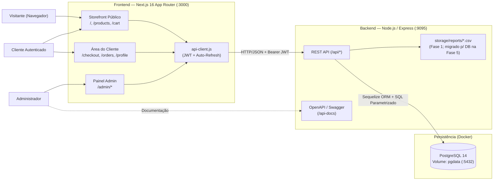
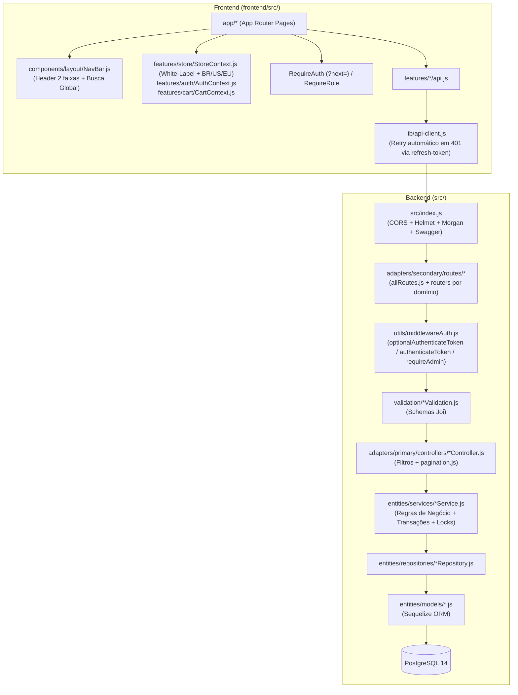
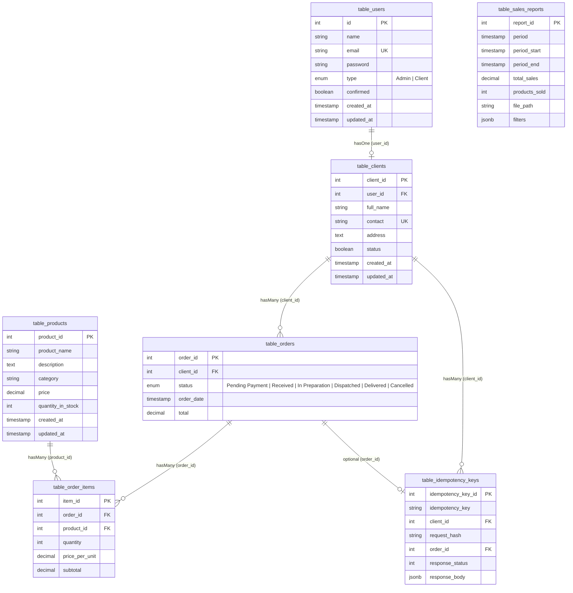
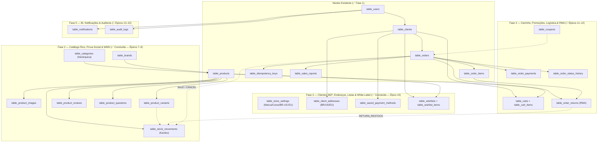
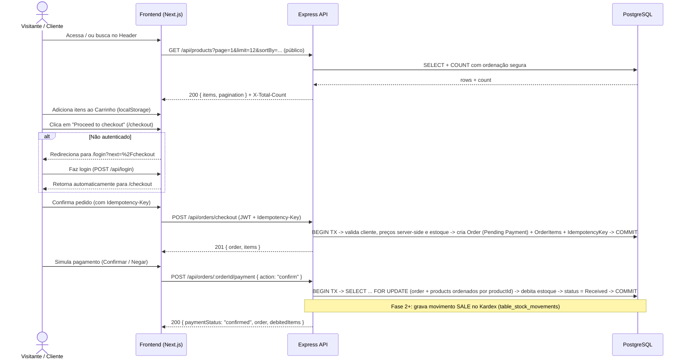
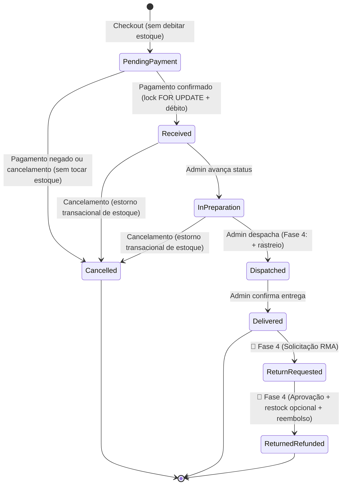

# Arquitetura do Sistema — `ecommerce-chall` (omni.store — Plataforma E-commerce White-Label)

Documento vivo da arquitetura da plataforma **omni.store** (e-commerce próprio *single-store* white-label + backoffice/ERP com UX inspirada na Amazon, tema azul piscina/branco + escuro e suporte multi-região **Brasil / EUA / Europa**). Combina a fotografia exata do estado atual (**As-Is — Fases 1, 2 e 3 concluídas, 19 tabelas ativas**) com o desenho-alvo das próximas entregas (**To-Be — Fases 4 e 5**), mantido em sincronia com o [BACKLOG.md](../BACKLOG.md) e com a nota técnica de pedidos em [order-workflow.md](./order-workflow.md).

> **Escopo Arquitetural:** Plataforma de **loja única white-label** (sem marketplace multi-vendedor). Pensada para portfólio e adaptação rápida a negócios reais no **Brasil (`pt-BR / BRL R$`)**, **EUA (`en-US / USD $`)** e **Europa (`en-IE / EUR €`)**.

> **Legenda de Status**
> - `✅ Implementado` — já presente no código, migrations e testes.
> - `🚧 Planejado (Fase X)` — desenhado como alvo para orientar migrations, chaves estrangeiras e fronteiras entre módulos antes da codificação.

---

## 1. Contexto do Sistema e Topologia de Execução (C4 Níveis 1–2)

### Modos de Execução

| Modo | Comando | O que roda no Docker | Quando usar |
| --- | --- | --- | --- |
| **Desenvolvimento Híbrido (Padrão)** `✅` | `docker compose up -d` + `npm run dev` (raiz e `frontend/`) | Apenas `db` (PostgreSQL 14 com volume `pgdata`) | Dia a dia de código no Windows (hot-reload rápido, testes locais ágeis). |
| **Demo Full-Stack Containerizada** `✅` | `docker compose --profile full up --build` | `db`, `backend` e `frontend` | Demonstração/portfólio com 1 comando sem instalar Node local. |
| **Produção Serverless (Futuro)** `🚧 Vercel` | 2 projetos Vercel + PostgreSQL gerenciado (Neon/Supabase) | Nenhum (Serverless Functions) | Publicação online (`VERCEL-01` a `VERCEL-06`). |

---

## 2. Arquitetura Interna em Camadas (C4 Nível 3)

O projeto adota um **Monólito Modular em Camadas** (inspirado em Ports & Adapters / Hexagonal simplificada) na API e uma organização por **Features + App Router** no Frontend.

### Mapa de Diretórios e Fronteiras

| Camada | Localização | Responsabilidade |
| --- | --- | --- |
| **Entrada / Infra HTTP** | `src/index.js`, `src/swagger.js` | Express, CORS (expondo headers de paginação/idempotência), Helmet, Swagger UI. |
| **Rotas & Segurança** | `src/adapters/secondary/routes/`, `src/utils/middlewareAuth.js` | Composição de rotas `/api/*`, autenticação JWT obrigatória/opcional e RBAC (`Admin` vs `Client`). |
| **Validação de Entrada** | `src/validation/`, `src/utils/validationUtils.js` | Validação Joi antes de atingir controllers/banco (garante 400 consistente). |
| **Controllers** | `src/adapters/primary/controllers/` | Tradução HTTP ↔ Serviço, montagem de filtros e paginação (`src/utils/pagination.js`). |
| **Services (Domínio)** | `src/entities/services/` | Regras de negócio, máquina de estados, transações atômicas, locks `FOR UPDATE`, geração SQL+CSV. |
| **Repositories & Models** | `src/entities/repositories/`, `src/entities/models/` | Acesso a dados Sequelize, associações e serialização `toDict()`. |
| **Migrations & Seeds** | `src/database/migrations/`, `src/database/seeders/` | Evolução versionada do schema PostgreSQL e carga idempotente de demonstração. |

---

## 3. Modelo de Dados (DER) — Atual vs. Alvo

### 3.1 Estado Atual — 7 Tabelas Implementadas (`✅ Fase 1`)

### 3.2 Arquitetura Alvo por Domínio — Expansão para 22 Tabelas (`🚧 Fases 2 a 5`)

O diagrama abaixo mostra como os novos módulos se conectam às 7 tabelas base sem quebrar retrocompatibilidade:

---

## 4. Fluxos Críticos e Máquina de Estados

### 4.1 Fluxo de Compra de Ponta a Ponta (Vitrine Pública → Checkout Idempotente → Pagamento)

### 4.2 Máquina de Estados de Pedido

---

## 5. Matriz de Autenticação, RBAC e Contratos REST (`✅ Fase 1`)

### 5.1 Controle de Acesso por Perfil

| Domínio / Rota | Visitante (sem JWT) | `Client` (JWT) | `Admin` (JWT) |
| --- | --- | --- | --- |
| `POST /api/login`, `POST /api/signin`, `GET /api/confirmation/:token`, `GET\|POST /api/refresh-token` | ✅ Público | ✅ | ✅ |
| `GET /api/products`, `GET /api/products/categories`, `GET /api/products/:id`, `POST /api/products/filters` | ✅ Público (`optionalAuth`) | ✅ | ✅ |
| `POST/PUT/DELETE /api/products/*` | ❌ 400 | ❌ 403 | ✅ |
| `GET/PUT /api/users/:id`, `PUT /api/change-password` | ❌ 400 | ✅ Próprio usuário | ✅ Todos |
| `GET/POST/DELETE /api/users` | ❌ 400 | ❌ 403 | ✅ |
| `GET/POST/PUT /api/clients/*` | ❌ 400 | ✅ Próprio perfil | ✅ Todos |
| `DELETE /api/clients/:id` | ❌ 400 | ❌ 403 | ✅ |
| `POST /api/orders/checkout`, `GET /api/orders/*`, `POST /api/orders/:id/payment`, `POST /api/orders/:id/cancel` | ❌ 400 | ✅ Próprios pedidos | ✅ Todos |
| `PATCH /api/orders/:id/status`, `PUT/DELETE /api/orders/:id` | ❌ 400 | ❌ 403 | ✅ |
| `/api/reports/*` (CRUD + download CSV) | ❌ 400 | ❌ 403 | ✅ |

### 5.2 Convenções de API

* **Paginação e Ordenação (`src/utils/pagination.js`):**
  * Query params padrão: `?page=1&limit=20&sortBy=<campo>&sortOrder=asc|desc`.
  * Toda coluna `sortBy` passa por *allowlist* no controller (mitiga SQL injection) e aplica *tie-breaker* pelo ID primário para páginas determinísticas.
  * Headers de resposta expostos no CORS: `X-Total-Count`, `X-Page`, `X-Limit`, `X-Total-Pages`, `Idempotency-Replayed`.
  * Retrocompatibilidade: quando `page` e `limit` não são enviados, os endpoints mantêm o formato original (ex.: array em `GET /api/products`); quando enviados, incluem o objeto `pagination`.
* **Formato de Erros (`src/utils/errorHandler.js`):**
  * Erros de validação Joi e de negócio seguem status semânticos (`400` validação/header, `401` token inválido/expirado, `403` RBAC, `404` não encontrado, `409` conflito de estoque/transição/idempotência).

---

## 6. Decisões Arquiteturais (ADRs) e Evolução por Fase

### Decisões Registradas

1. **ADR-01 — Monólito Modular em vez de Microsserviços:** mantém transações ACID entre Pedidos, Estoque/Kardex, Cupons e Carteira em um único banco PostgreSQL, evitando complexidade prematura de Sagas/mensageria distribuída.
2. **ADR-02 — Proteção contra Oversell com Lock Determinístico:** `SELECT ... FOR UPDATE` nos produtos sempre ordenados por `productId` crescente dentro da transação de pagamento/cancelamento, eliminando race conditions e deadlocks.
3. **ADR-03 — Preços Server-Side em Centavos Inteiros:** totais nunca vêm do cliente; cálculos financeiros usam inteiros em centavos (`toCents`) para evitar desvios de ponto flutuante (`IEEE 754`).
4. **ADR-04 — Snapshots Imutáveis nos Pedidos (Fase 4):** endereço de entrega e metadados/custo do produto serão copiados em `JSONB` no momento do checkout para que edições futuras no catálogo não alterem pedidos ou relatórios financeiros históricos.
5. **ADR-05 — Persistência de Relatórios em Banco (Fase 5):** armazenar `summaryMetrics`, `rowsData` (`JSONB`) e `csvContent` (`TEXT`) em `table_sales_reports` viabiliza inspeção de relatórios históricos na UI e remove dependência de filesystem local (alinhando com `VERCEL-04`).
6. **ADR-06 — Infra Híbrida no Desenvolvimento:** PostgreSQL containerizado + Back/Front locais no host por padrão (`docker compose up -d`), com stack containerizada opcional sob `--profile full`.
7. **ADR-07 — Single-Store White-Label Multi-Região (BR / US / EU):** opção consciente por loja única (sem multi-vendedor) com identidade visual, moeda (`BRL`/`USD`/`EUR`), idioma e regras fiscais/postais (`CEP`/`ZIP`/`Postal Code`, `CPF/CNPJ`/`Tax ID`/`VAT ID`) parametrizadas via `StoreContext` (Fase 1) e `table_store_settings` (Fase 3), facilitando vendas personalizadas para negócios no Brasil, EUA e Europa.

### Roadmap Arquitetural por Fase

| Fase | Épicos | Principais Mudanças Arquiteturais | Status |
| --- | --- | --- | --- |
| **Fase 1 (P0)** | Épico 6 | Vitrine pública (`optionalAuthenticateToken`), paginação/ordenação universal, `/api/products/categories`, Header/Home White-Label (`omni.store`), Tema Azul Piscina + Escuro, Presets Multi-Região (BR/US/EU), 50 produtos reais em disco, Docker profile `full`. | `✅ Concluída` |
| **Fase 2 (P1)** | Épicos 7–9 | Categorias hierárquicas, Marcas, Galeria, Variantes, PDP em 3 colunas, Reviews verificadas + histograma, Q&A + `/admin/reviews`, Kardex (`table_stock_movements`) + `/admin/inventory` e soft-archive de produtos. | `✅ Concluída` |
| **Fase 3 (P2)** | Épico 10 | Painel White-Label (`table_store_settings` + `/admin/settings`), Clientes 360º (documentos BR/US/EU, tier, pontos, crédito), Múltiplos Endereços internacionais + ViaCEP, Carteira simulada, Wishlist e Salvar para depois. | `✅ Concluída` |
| **Fase 4 (P3)** | Épicos 11–12 | Carrinho sincronizado, Cupons, Frete regional, Checkout 3 passos (PIX/Boleto/Cartão/SEPA), Snapshots, Timeline auditável, Recibo/Invoice, `/admin/orders` e RMA/Devoluções. | `🚧 Próxima` |
| **Fase 5 (P4)** | Épicos 13–15 | Dashboard BI (`/admin/dashboard`), 6 Relatórios persistidos (Curva ABC, RFM/LTV, Giro, Margem), Notificações, Auditoria e Seeder completo. | `🚧 Planejada` |

---

## 7. Definition of Done (DoD) Arquitetural por Fase

Ao encerrar cada fase do backlog:
- [ ] Migrations criadas e reversíveis (`up` e `down`) sem quebrar dados existentes.
- [ ] `docs/architecture.md` atualizado promovendo os módulos concluídos de `🚧` para `✅`.
- [ ] `src/swagger-output.json` regenerado (`npm run swagger`).
- [ ] Backend verde: `npm run lint`, `npm run test:unit`, `npm run test:contract` (e `test:e2e` quando houver banco de teste).
- [ ] Frontend verde: `npm run lint`, `npm test` (Jest) e `npm run build` (`next build`).
- [ ] Itens marcados como `[x]` em [BACKLOG.md](../BACKLOG.md).
